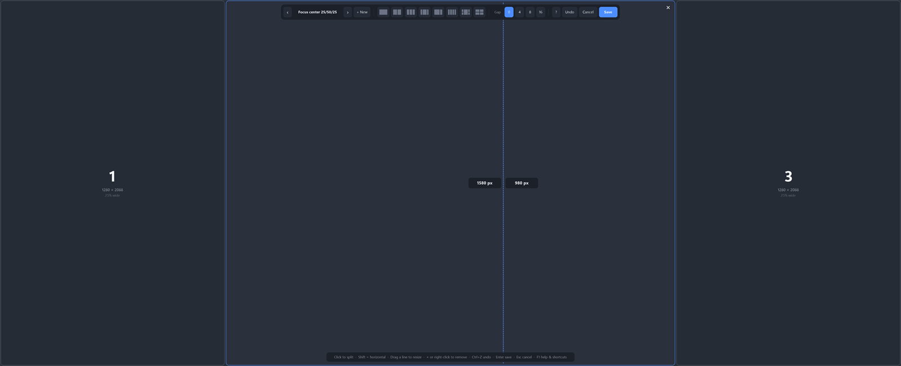
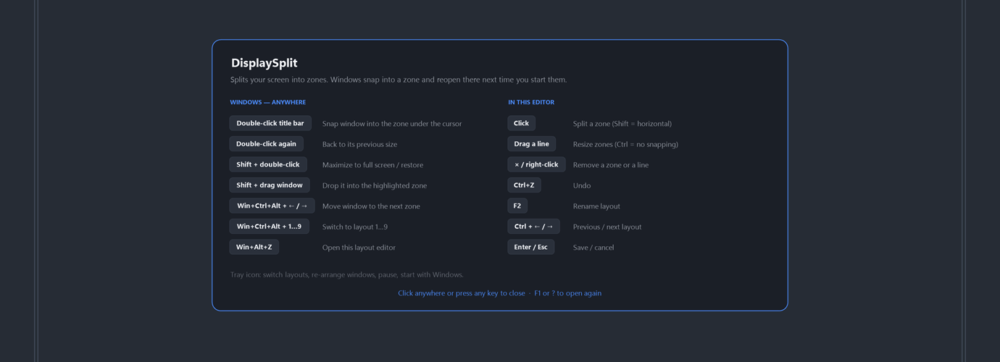

# DisplaySplit

[](https://github.com/artkuc/DisplaySplit/actions/workflows/ci.yml)
[](https://github.com/artkuc/DisplaySplit/releases/latest)
[](LICENSE)

**Split your (ultrawide) monitor into zones. Double-click any window's title bar to snap it into the zone under the cursor.**

A tiny, fast tray utility for Windows 10/11, in the spirit of DisplayFusion's monitor splitting or FancyZones, built to
stay out of your way. Apps also reopen in the zones they had last time.



## Features

- **Double-click a title bar**: the window fills the zone under the cursor. Double-click again to restore its
  previous size.
- **Shift + double-click a title bar**: the window maximizes to the full monitor. Do it again to restore.
- **Hold Shift while dragging a window**: zones light up, and releasing drops the window into the highlighted zone.
- **Remembers where apps belong.** After a reboot or relaunch, windows reopen in their zones.
  - Multi-window apps are matched by window title.
  - Apps keep their place after updates.
  - Windows that are already open at logon are arranged as well.
- **Layout editor**:
  - Click to split, drag lines to resize, × to remove.
  - 8 presets, several named layouts per monitor, optional gaps, undo.
  - Built-in help with every shortcut (`F1`).
- **Light**: event-driven with no timers while idle (0 % CPU), about 9 MB of private memory, a single small exe.
- **Private**: no network access, no telemetry. Settings are local JSON files.



## Install

1. Download **`DisplaySplit-<version>-win-x64.exe`** from the
   [latest release](https://github.com/artkuc/DisplaySplit/releases/latest). It's a standalone build: nothing to
   install, no .NET required.
2. Put it somewhere permanent, for example `%LOCALAPPDATA%\Programs\DisplaySplit\`.
3. Run it. The layout editor opens with a starting layout: 25 / 50 / 25 on ultrawide screens, otherwise full screen.
   Adjust it and press **Enter**.

DisplaySplit registers itself to **start with Windows** (per user, no admin rights needed). You can turn that off in
the tray menu.

> **SmartScreen:** the exe isn't code-signed yet, so Windows may show "Windows protected your PC" on first launch.
> Choose **More info → Run anyway**. `SHA256SUMS.txt` on the release page lets you verify the download.

A smaller *framework-dependent* build (~1 MB) is also attached to each release. It needs the
[.NET 10 runtime](https://dotnet.microsoft.com/download/dotnet/10.0).

**Uninstall:** untick *Start with Windows* (and *Manage admin windows*, if you turned it on) in the tray menu, choose
**Exit**, then delete the exe and `%APPDATA%\DisplaySplit`. If you used admin mode, also delete
`C:\Program Files\DisplaySplit` (needs administrator rights).

## Usage

### Windows, anywhere

| Action | Shortcut |
|---|---|
| Snap window into the zone under the cursor | Double-click its title bar |
| Back to its previous size | Double-click the title bar again |
| Maximize to full screen / restore | **Shift** + double-click the title bar |
| Drop into a zone | Hold **Shift** while dragging a window |
| Move window to the previous / next zone | `Win+Ctrl+Alt+←` / `→` |
| Switch to layout 1…9 | `Win+Ctrl+Alt+1…9` |
| Open the layout editor | `Win+Alt+Z`, left-click the tray icon, or start the exe again |

### Layout editor

| Action | How |
|---|---|
| Split a zone | Click inside it. Hold **Shift** for a horizontal split |
| Resize zones | Drag the line between them. Lines snap to 1/12ths; hold **Ctrl** to turn snapping off |
| Remove a zone or a line | Hover and click its **×**, or right-click it |
| Undo | `Ctrl+Z` |
| Several layouts | `+ New` duplicates the current layout; switch with `‹ ›` or `Ctrl+←/→`. `F2` renames |
| Help & shortcuts | `F1` or the **?** button |
| Save / cancel | `Enter` / `Esc` |

### Tray menu

The tray menu lets you:
- switch layouts, or add a new one from a preset;
- re-apply remembered positions with *Arrange all windows now*;
- stop remembering one app with *Don't remember "…"*, and undo that under *Excluded apps*;
- toggle features, pause, and turn *Start with Windows* on or off;
- turn on *Manage admin windows* (see below).

### Windows of apps that run as administrator

Windows doesn't let a normal app move the windows of an app that runs as administrator. To manage those too, tick
**Manage admin windows** in the tray menu. It is offered to administrator accounts with the standalone build.

- Windows asks for administrator rights **once**, when you turn it on. After that DisplaySplit starts with
  administrator rights without a prompt, also at sign-in.
- DisplaySplit copies itself to `C:\Program Files\DisplaySplit` and adds an on-demand scheduled task,
  `DisplaySplit-Admin-<your SID>`, that starts that copy elevated. Only administrators can change the copy or the task.
  Starting DisplaySplit normally (or at sign-in) hands over to that task.
- While it is on, settings live in `C:\Program Files\DisplaySplit\data\<your SID>` (only you can read them, only
  administrators can change them). Turning it off moves them back to `%APPDATA%\DisplaySplit`.
- To update: untick the item, exit, start the new exe and tick the item again. (Starting a different copy while it is
  on just starts the installed copy. It deliberately doesn't offer to install itself, so no other program can use
  DisplaySplit's own dialog to talk you into a UAC prompt.)
- Untick the item to turn it off: the task is removed and DisplaySplit restarts without administrator rights. The copy
  in `C:\Program Files\DisplaySplit` stays (autostart uses it); delete that folder as administrator to remove it.

Only turn this on for a copy of DisplaySplit you trust: it runs with full administrator rights. Starting DisplaySplit
with *Run as administrator* doesn't work any more: it restarts itself without administrator rights, because an elevated
process must not use the normal settings folder.

Windows 11 puts new tray icons in the overflow area (^). Drag the icon onto the taskbar to keep it visible.

## Known limitations

- **Admin windows**: Windows doesn't let a normal app move an elevated (admin) window, so those keep their native
  title-bar behaviour unless you turn on [Manage admin windows](#windows-of-apps-that-run-as-administrator)
  (standalone build only).
- **Custom title bars**: some apps (for example the Windows 11 Explorer tab strip) only report a title bar to their top
  window. DisplaySplit only takes over their double-click when the click really started a window move. Otherwise
  Windows' own maximize happens.
- **Fixed-size windows**: windows without a resize border are centred in the zone instead of stretched.
- **Edge snapping**: Windows' own edge snapping can also trigger while Shift-dragging at the very edge of the screen.

## Building from source

You need Windows 10/11 x64 and the [.NET 10 SDK](https://dotnet.microsoft.com/download).

```powershell
git clone https://github.com/artkuc/DisplaySplit.git
cd DisplaySplit
dotnet build DisplaySplit.slnx
dotnet test  tests/DisplaySplit.Tests
dotnet publish src/DisplaySplit -c Release -o publish                       # ~1 MB, needs .NET runtime
dotnet publish src/DisplaySplit -c Release -p:PublishAot=true -o publish    # standalone; needs VS C++ build tools
```

See [CONTRIBUTING.md](CONTRIBUTING.md) for the project layout, tests and guidelines, and
[docs/PLAN.md](docs/PLAN.md) for the design.

### How it works, briefly

1. A low-level mouse hook spots double-clicks on a dedicated high-priority thread. On the first click, a separate
   probe thread asks the window under the cursor (`WM_NCHITTEST`) whether that spot is its title bar.
2. If it is, the hook swallows the second click, so the app never maximizes itself, and the window is moved into the
   zone.
3. Calls into other processes that could block run on a placement worker thread with a watchdog. A hung app therefore
   can't freeze the UI.
4. Each app's windows are remembered as "slots" that hold the zone for every layout. When a new window of that app
   appears, it is placed in its slot and watched for a few seconds. Apps like Chrome or VS Code restore their own
   bounds right after opening, so this watch puts them back.

## Feedback

Bug reports and feature ideas are welcome as [issues](https://github.com/artkuc/DisplaySplit/issues/new/choose).
This repository doesn't accept pull requests from outside contributors. See [CONTRIBUTING.md](CONTRIBUTING.md) for
details. Report security issues privately; see [SECURITY.md](SECURITY.md).

## License

[MIT](LICENSE) © artkuc and DisplaySplit contributors.
